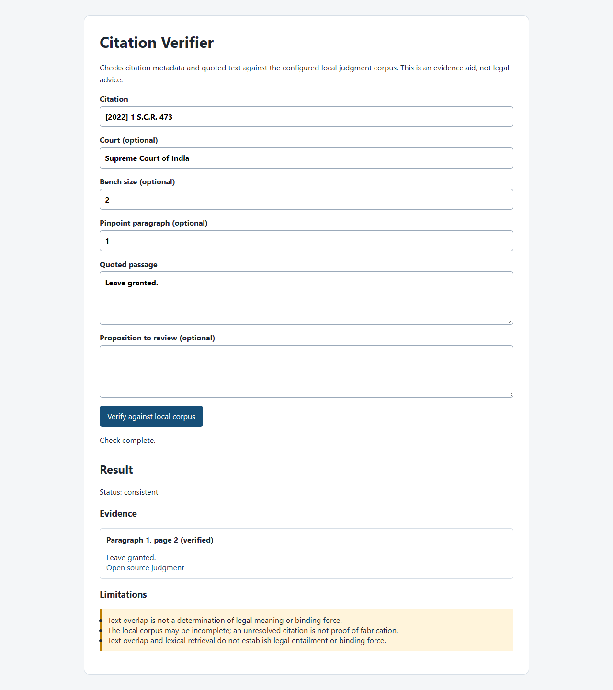

# Indian Citation Integrity Verifier

An evidence-first local check for Indian Supreme Court citation metadata and quoted text. The tool returns source-linked paragraphs and uncertainty-aware findings; it does not determine legal entailment, ratio/obiter, binding force, or later treatment.

**Final report:** [7-page IEEE PDF](report/Final_Report.pdf) · [Submission checklist](docs/SUBMISSION.md)

**Repository:** https://github.com/INSANE0777/indian-citation-integrity-verifier (private)



## Quick start

```sh
python -m pip install -e .
python -m pip install -e ".[test,report]"
python -m pytest tests -q
python -m citation_verifier verify --corpus data/corpus.jsonl --input examples/request.json --pretty
python -m citation_verifier serve --corpus data/corpus.jsonl --host 127.0.0.1 --port 8765
```

Open `http://127.0.0.1:8765/` for the dependency-free browser demonstration. The example request is drawn from a retained real judgment and intentionally includes a proposition that must receive human review. The CLI also accepts one JSON object on stdin when `--input` is omitted. Errors are JSON on stderr with a non-zero exit code.

## What is checked

- metadata-backed neutral/SCR and supplied reporter aliases;
- court and known bench-size agreement;
- original numbered paragraph pinpoints where extraction supports them;
- exact or normalized contiguous quotation presence, including numbers and negations;
- nearby lexical candidate paragraphs when a quote fails;
- immediately adjacent qualification cues as review prompts;
- provenance, source URL, SHA-256 and extraction uncertainty.

`consistent` means the submitted mechanical checks passed within this local extraction. `inconsistent` means a mechanical discrepancy was detected. `review` means a proposition, qualification, missing metadata or extraction uncertainty needs a human. `unresolved` means the citation was absent or ambiguous in this bounded corpus. An unresolved local lookup is not proof of a fabricated authority.

## Data and attribution

`data/corpus.jsonl` is a bounded, real English Supreme Court slice acquired from the [Indian Supreme Court Judgments AWS Open Data collection](https://registry.opendata.aws/indian-supreme-court-judgments/) under CC-BY-4.0. `data/manifest.json` records selection, failures, retained count, hashes/provenance policy and the fact that automatically extracted paragraph completeness is not verified. The acquisition code is resumable:

```sh
python scripts/ingest_corpus.py --limit 2000 --years 2023 2022 --workers 8
```

The selected registry keys were 1,873; 385 PDFs produced usable bounded records and 1,488 were recorded as failures. This shortfall is intentionally visible. The project does not claim to be a complete citator or a comprehensive Indian case-law database. Raw downloads, model weights and the supplied course PDFs are excluded from Git.

## Evaluation

The evaluation script creates deterministic judgment-disjoint development/test splits before mutations, reports status and triage metrics, compares citation-only/literal/normalized/full baselines, and optionally compares BM25 with a pinned SentenceTransformer encoder. Run:

```sh
python -m pip install -e ".[gpu]"
python scripts/run_experiments.py --corpus data/corpus.jsonl --out results --model-revision 1110a243fdf4706b3f48f1d95db1a4f5529b4d41
```

Read `docs/EVALUATION.md` and `docs/VIVA_GUIDE.md` before presenting the numbers. Controlled mutations are not naturally occurring legal hallucinations. Retrieval overlap is not legal entailment; GPU inference is an optional comparison and not required by the core verifier.

## Report

`report/Final_Report.pdf` is the verified seven-page final report. `report/main.tex` is the editable IEEE conference source. `report/measurements.tex` and `report/bibliography.tex` are generated from experiment/reference artifacts. Run `python scripts/build_report.py` using Tectonic as described in [report/BUILD.md](report/BUILD.md). The report is written to the prescribed 6–7 page structure and preserves unknown faculty/team fields rather than guessing them.

## Project structure

- `src/citation_verifier/core.py` — validated corpus, canonical citation index, evidence checks.
- `src/citation_verifier/evaluation.py` — controlled cases, metrics, splits, BM25.
- `src/citation_verifier/__main__.py`, `web.py`, `web.html` — CLI and localhost demo.
- `scripts/ingest_corpus.py`, `scripts/run_experiments.py` — acquisition and measurements.
- `data/` — retained corpus, data card, manifest.
- `tests/` — parser, core, interface and evaluation checks.
- `docs/` — demo, evaluation and viva instructions.
- `report/` — IEEE source and generated measurement inputs.

## Limits and responsible use

This is a research prototype and an assistive source checker. It cannot establish that a proposition is legally supported, that quoted text is the court's holding, that an authority remains good law, or that an absent local record never existed. Verify professional work against the original record and obtain qualified legal review. Team members must replace the contribution placeholder with truthful attestations and obtain any faculty-assigned Team ID before submission. The source PDF lists the student names and identifiers; the repository does not invent contribution claims.

## Licensing and hosting

The extracted court corpus retains CC-BY-4.0; see `data/DATA_CARD.md` for attribution and transformations. No project-code reuse license has been selected. This private repository is source hosting, not a public deployment. GitHub Pages cannot run the Python verification server. Invite authorized reviewers to the repository before sending a submission link.
